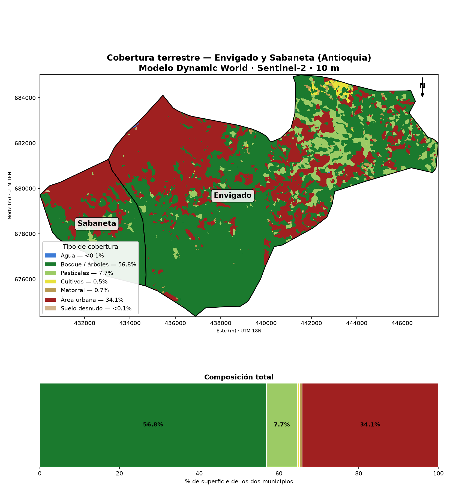
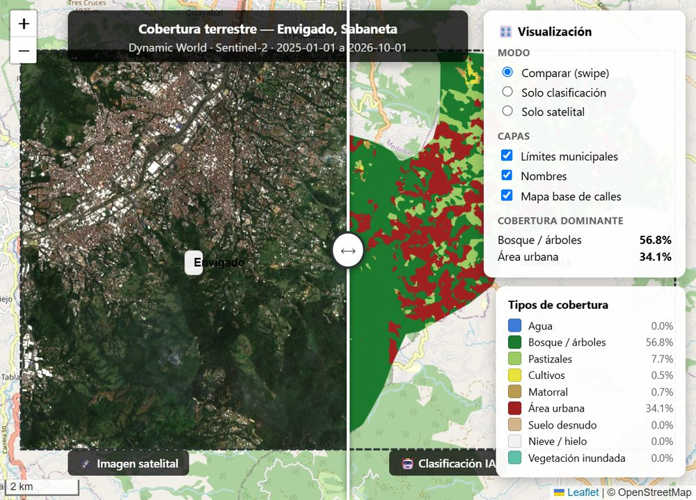

# Clasificador de Cobertura Terrestre — Envigado y Sabaneta 🇨🇴

Programa en Python que detecta el **tipo de cobertura terrestre** (bosque,
cultivos, área urbana, agua, etc.) de los municipios de **Envigado** y
**Sabaneta** (Antioquia, Colombia) usando **modelos de inteligencia
artificial de código abierto**.

## ¿Cómo funciona?

| Componente | Tecnología |
|---|---|
| Imágenes de entrada | **Sentinel-2** (Agencia Espacial Europea, resolución 10 m) |
| Modelo de IA | **Dynamic World** ([dynamicworld.app](https://dynamicworld.app)) — red neuronal de código abierto de Google + WRI |
| Plataforma de cómputo | **Google Earth Engine** (todo el procesamiento ocurre en la nube; tu PC no necesita GPU) |
| Límites administrativos | Colección **FAO/GAUL 2025** disponible en Earth Engine |

El modelo clasifica **cada píxel** de la imagen en una de 9 clases de
cobertura, promediando la probabilidad a lo largo de todas las escenas
sin nubes del período de análisis.

### Clases de cobertura

| # | Clase | Color en el mapa |
|---|---|---|
| 0 | Agua | 🔵 Azul |
| 1 | Bosque / árboles | 🟢 Verde oscuro |
| 2 | Pastizales | 🟩 Verde claro |
| 3 | Cultivos | 🟡 Amarillo |
| 4 | Matorral | 🟤 Beige |
| 5 | Área urbana | 🔴 Rojo |
| 6 | Suelo desnudo | 🟫 Arena |
| 7 | Nieve / hielo | ⚪ Blanco |
| 8 | Vegetación inundada | 🟦 Turquesa |

## Resultados obtenidos

Ejecución del 13 de octubre de 2026, con 94 escenas de Sentinel-2
(enero 2025 → octubre 2026) sobre los 96.2 km² de los dos municipios:

| Cobertura | Superficie |
|---|---|
| Bosque / árboles | 56.83% |
| Área urbana | 34.15% |
| Pastizales | 7.75% |
| Matorral | 0.67% |
| Cultivos | 0.54% |
| Suelo desnudo | 0.05% |
| Agua | 0.02% |

Se observa claramente la franja urbana del norte (valle de Aburrá) y la
masa forestal del sureste rural de Envigado (corregimientos de Altavista
y Guayabal).



## Requisitos

- Python 3.10 o superior
- Cuenta de Google **con Earth Engine aprobada**: https://earthengine.google.com/
- Un proyecto de Google Cloud con la **API de Earth Engine habilitada**

## Instalación

```bash
# 1. Clonar el repositorio
git clone https://github.com/andkastro77-cpu/clasificador-cobertura-colombia.git
cd clasificador-cobertura-colombia

# 2. Crear entorno virtual e instalar dependencias
python -m venv .venv
.venv\Scripts\activate        # Windows
pip install -r requirements.txt

# 3. Configurar el proyecto de Google Cloud
$env:EE_PROJECT_ID = "tu-proyecto"   # PowerShell
# export EE_PROJECT_ID="tu-proyecto"  # Linux/macOS
```

La **primera ejecución** abrirá el navegador para autorizar tu cuenta de
Earth Engine (solo se hace una vez).

## Uso

```bash
python main.py
```

## Salidas

Los resultados se guardan en la carpeta `salidas/`:

- **`mapa_cobertura_sabaneta_envigado.png`** — mapa temático con leyenda y límites municipales
- **`estadisticas_sabaneta_envigado.csv`** — porcentaje de superficie por tipo de cobertura
- **`cobertura_sabaneta_envigado.tif`** — ráster georreferenciado (compatible con QGIS)
- **`comparacion.html`** — visor interactivo con comparación deslizante (ver abajo)

## Visor interactivo: satélite vs IA

`comparacion.html` es un archivo que se abre con **doble clic** en
cualquier navegador. No necesita instalar nada y contiene todo dentro de
un solo archivo (imágenes en base64 + librerías incrustadas), así que
**funciona sin conexión a internet**, salvo el mapa base de calles.



| Herramienta | Qué hace |
|---|---|
| **Divisor deslizante** (⟶) | Arrástralo con el mouse para revelar la imagen satelital a un lado y la clasificación de la IA al otro. Es la misma idea que la herramienta de comparación de **ERDAS Imagine**. Doble clic lo devuelve al centro. |
| **Modo** | Alterna entre *Comparar (swipe)*, *Solo clasificación* y *Solo satelital*. |
| **Capas** | Enciende o apaga los límites municipales, los nombres y el mapa base de calles. |
| **Leyenda** | Muestra los 9 tipos de cobertura con su porcentaje calculado. |

La imagen satelital es una **composición en color natural** (rojo, verde y
azul) de Sentinel-2, promediando todas las escenas sin nubes del período
para eliminar las nubes. Las dos capas se descargan con el mismo tamaño
de píxel para que el divisor compare exactamente el mismo terreno.

Para cambiar el ancho de las capas (más detalle = archivo más pesado),
ajusta `ANCHO_MAXIMO` en `comparar.py`. Para desactivar el visor, pon
`GENERAR_VISOR = False` en `config.py`.

## Visualizar los resultados

| Resultado | Cómo verlo |
|---|---|
| Visor interactivo | Doble clic en `comparacion.html` (se abre en el navegador) |
| Mapa PNG | Doble clic en el archivo (VS Code lo muestra sin salir) |
| Estadísticas CSV | Abrirlo como texto, o con la extensión *Rainbow CSV* para verlo en columnas |
| Ráster GeoTIFF | Con **QGIS**, o ejecutando el script incluido: |

```bash
python ver_raster.py
```

Este script muestra el GeoTIFF en pantalla con sus coordenadas UTM, sin
necesidad de instalar QGIS. Útil para inspeccionar el ráster completo
(sin el recorte municipal que aplica `main.py`).

## Estructura del proyecto

```
clasificador-cobertura-colombia/
├── config.py      # Parámetros: municipios, fechas, nubes, clases y colores
├── auth.py        # Autenticación con Google Earth Engine
├── zonas.py       # Límites de Sabaneta y Envigado (FAO/GAUL)
├── clasificar.py  # Motor: Sentinel-2 + Dynamic World
├── reporte.py     # Mapa PNG, estadísticas CSV y descarga GeoTIFF
├── comparar.py    # Visor interactivo comparacion.html (swipe satélite vs IA)
├── main.py        # Orquestador del flujo completo
├── ver_raster.py  # Muestra el GeoTIFF en pantalla (alternativa a QGIS)
├── visor/         # Librerías Leaflet incrustadas en el HTML (no editar)
├── requirements.txt
└── salidas/       # Resultados generados
```

## Configuración

Todo se ajusta en **`config.py`**:

- `MUNICIPIOS` — cambiar la zona de estudio
- `FECHA_INICIO` / `FECHA_FIN` — período de análisis
- `MAX_NUBES` — umbral de nubes por escena (%)
- `ESCALA_M` — resolución del ráster de salida
- `GENERAR_VISOR` — activar o desactivar el visor interactivo

## Licencia

MIT — libre para uso académico y personal.
